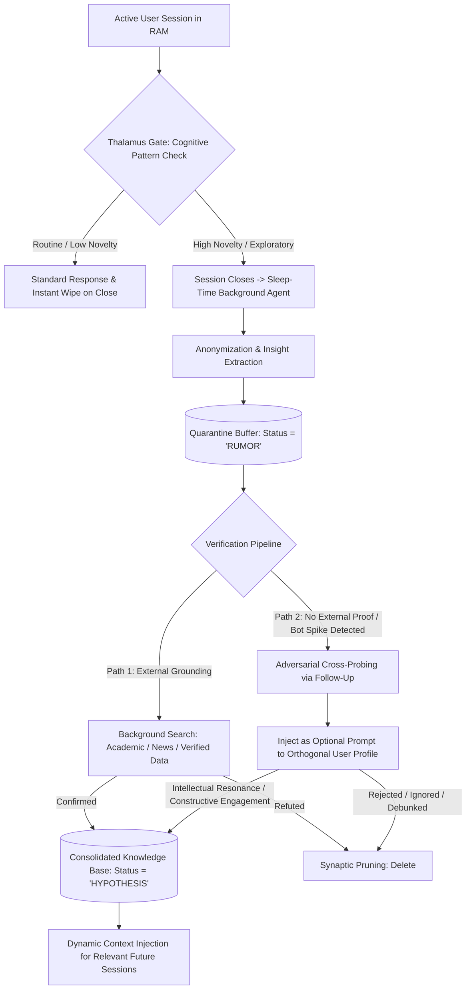

# Bio-Mimetic Continual Learning Architecture (The "Rumor Mill" Protocol)

**Status:** Request for Comments (RFC) / Conceptual Architecture  
**Domain:** Artificial Intelligence, Agentic Memory, Continual Learning, Bot Mitigation  

---

## 1. Executive Summary

Current Large Language Models (LLMs) suffer from a fundamental trade-off known as the **Stability-Plasticity Dilemma**: updating model weights in real time leads to *Catastrophic Forgetting* and prohibitive compute costs, while freezing weights prevents continuous learning from live user interactions. Furthermore, naive shared-memory systems are highly vulnerable to **Memory Poisoning** and coordinated bot-farm attacks.

This document proposes a **Bio-Mimetic Episodic Memory Architecture** inspired by human neurophysiology (specifically thalamic gating, sleep-dependent synaptic pruning, and hemispheric adversarial testing). Instead of modifying base model weights, the system achieves real-time continual learning in volatile memory (RAM/Context) through a quarantined **"Rumor Mill" validation pipeline** and **Adversarial Follow-up Probing**.

---

## 2. Core Architectural Principles

1. **Zero Weight Mutation:** Base model weights remain frozen to eliminate catastrophic forgetting. Learning occurs dynamically via structured context injection (*In-Context Episodic Consolidation*).
2. **Metabolic Compute Gating (The "Thalamus" Filter):** Just as the human brain conserves glucose by relying on fast heuristics for routine tasks, the system classifies user cognitive patterns within the first 1–3 turns. Routine queries bypass deep memory consolidation.
3. **Quarantined Hypothesis Buffer ("Rumor" State):** Novel insights extracted from user sessions are never immediately trusted. They are anonymized and placed in a low-trust quarantine state (*Rumor*) until verified.
4. **Adversarial Cross-Probing (Bot & Echo-Chamber Defense):** Instead of relying on consensus volume (which bot farms can spoof), unverified *Rumors* are tested for intellectual viability by injecting them as optional conversational follow-ups to users with **orthogonal (opposing) cognitive profiles**.

---

## 3. System Data Flow & Lifecycle

---

## 4. Component Breakdown

### 4.1. Thalamus Gate (Adaptive Compute Router)
* **Mechanism:** Evaluates semantic depth, linguistic complexity, and exploratory intent in the initial turns of a dialogue.
* **Function:** Assigns a *Compute Priority Score*. Low-scoring dialogues (e.g., weather checks, simple translations) are processed via lightweight pathways and purged immediately upon session termination, saving ~80% of background processing overhead.

### 4.2. Sleep-Time Consolidation Agent (Hippocampal Buffer)
* **Mechanism:** Triggered asynchronously when a high-priority session closes.
* **Function:** Strips all Personally Identifiable Information (PII), extracts novel problem-solving patterns or unindexed hypotheses, and writes them to a shared volatile store tagged as `Status: RUMOR`.

### 4.3. Dual-Layer Verification & The "Rumor Mill" Protocol
To prevent false data or coordinated bot-farm injection from polluting the shared context:
* **Layer 1 (External Grounding):** A background agent cross-references the `RUMOR` against external real-world data (scientific repositories, verified news, documentation).
* **Layer 2 (Adversarial Cross-Probing):** If external proof does not yet exist (e.g., a bleeding-edge engineering insight) or if an anomalous spike of identical claims is detected (potential bot attack), the system initiates a stress test:
  * It identifies an active session belonging to a user with an **opposing domain profile** (e.g., a strict skeptic or an engineer from an unrelated field) who exhibits a high *Exploratory Curiosity Index*.
  * At the natural conclusion of that user's primary task, the system appends the `RUMOR` as an **optional, non-intrusive follow-up question**.
  * **Evaluation:** If the orthogonal user dismisses or debunks the premise, the `RUMOR` undergoes *Synaptic Pruning* (deletion). If the user engages constructively and builds upon the logic, the concept survives the stress test and is promoted to `Status: HYPOTHESIS`.
### 4.4. Safeguard Modules (Emotional Cooldown & Stochastic Jury)
To handle emotionally charged viral claims and unresolvable 50/50 edge cases without centralizing moral authority:
* **Temporal Timeout (Emotional Cooldown):** If an incoming `RUMOR` triggers high emotional volatility or coordinated panic spikes, the system enforces a mandatory quarantine delay (`Cooldown_Interval`) before any cross-probing occurs. This prevents reactive human outrage from distorting the validation signal, allowing discourse to stabilize before testing.
* **Stochastic Human Jury (Algorithmic Sortition):** When adversarial cross-probing yields an exact parity deadlock (50/50 split) on subjective or high-stakes ambiguity, deterministic logic halts to prevent algorithmic bias. Instead, the system samples a small, anonymized, cross-cultural cohort of users with high *Exploratory Curiosity* scores and aggregates their independent reasoning to resolve the tie without hardcoding a single viewpoint.

### 4.5. Synaptic Summation & Threshold Integration (EPSP / IPSP Scoring)

Single-shot binary validation is insufficient for real-world human interactions. A user who encounters a genuinely novel idea may react with brief cognitive shock (*"Damn, that's a great idea, I need to think about this"*) and immediately disengage without writing a detailed follow-up. Conversely, an orthogonal skeptic may dismiss an unconventional insight out of hand (*"What kind of nonsense is this?"*) without providing factual refutation.

To prevent premature deletion of breakthrough ideas by a single critic—or false promotion by a single overly enthusiastic user—the quarantine buffer models **biological synaptic integration**:

- **Excitatory Postsynaptic Potentials (EPSP / Positive Weights):**
  - *Spontaneous Cognitive Disruption* (brief, high-surprise acknowledgment before disengagement): **+0.6**
  - *Constructive Elaboration* (user builds upon the logic or adds a new "verse" to the idea): **+0.8**
  - *Polite / Low-Effort Compliance* (e.g., *"interesting"*, *"maybe"*): **+0.1** (negligible impact to filter out sycophancy)
- **Inhibitory Postsynaptic Potentials (IPSP / Negative Weights):**
  - *Visceral Skeptical Rejection* (dismissal without factual proof): **-0.6**
  - *Verified Factual Debunking* (logical or empirical refutation): **-1.5** (triggers immediate pruning)
- **Action Potential Thresholds & Dormant ("Galileo") State:**
  - Each `RUMOR` circulates through multiple orthogonal probes, accumulating a net `synaptic_weight`.
  - **Promotion ($\ge +1.0$):** The cumulative excitatory signal crosses the firing threshold, promoting the entry to `Status: HYPOTHESIS`.
  - **Immediate Pruning ($\le -1.0$ with factual proof):** Inhibitory signals backed by refutation trigger microglial deletion (`Status: PRUNED`).
  - **Dormant State (Low-Compute Cold Archive):** Unconventional ideas that face visceral skepticism ($\le -1.0$) *without* factual debunking are not permanently deleted. Instead, they enter a 3-year low-compute `DORMANT` state ("Galileo" mode) to be periodically re-tested as external context matures, while planting cognitive seeds in the minds of early skeptics.
  - **Deadlock ($\approx 0.0$ after $N$ probes):** High-variance polarization (equal strong `+` and `-` reactions) formally defines the 50/50 tie state, escalating the item to the **Stochastic Human Jury**.

---

## 5. Biological Parallels Summary

| Biological Mechanism | AI System Equivalent | Purpose |
| :--- | :--- | :--- |
| **Thalamic Filtering** | Early-Turn Pattern Classifier | Prevents metabolic/compute exhaustion on trivial inputs. |
| **Sleep & Microglial Pruning** | Asynchronous Session Cleanup | Purges noise and prevents memory bloat. |
| **Prefrontal Skepticism** | Quarantine Buffer (`RUMOR` tag) | Prevents premature belief in unverified stimuli. |
| **Hemispheric Debate** | Orthogonal Follow-Up Probing | Stress-tests ideas against bias and bot manipulation. |
| **Limbic Regulation** | Temporal Timeout (`Cooldown_Interval`) | Prevents acute emotional panic from corrupting memory consolidation. |
| **Collective Deliberation** | Stochastic Human Jury | Resolves 50/50 ambiguity without centralized algorithmic bias. |
| **Synaptic Summation & Dormant Memory** | EPSP/IPSP Weights & Cold Archive | Balances surprise against skepticism and preserves ahead-of-their-time ideas. |

---

## 6. Open Questions for Implementation & Discussion

1. **Scoring Engagement:** What is the optimal metric to distinguish genuine *intellectual resonance* from polite user compliance during an adversarial follow-up probe?
2. **Decay Rates:** What half-life should be assigned to unverified `RUMOR` entries before automatic microglial pruning occurs?
3. **Privacy Guarantees:** Ensuring mathematical zero-leakage of proprietary user context during abstraction into generalized `RUMOR` vectors.

## 7. Quick Simulation

To run the standalone Python proof-of-concept demonstrating thalamic gating, bot-spike pruning, and stochastic jury resolution:

    python rumor_mill_sim.py

## 8. License & Commercial Use

This project is licensed under a **Dual Licensing** model to support open research while protecting the author's intellectual property:

* **Open-Source & Academic Research (`GNU AGPLv3`):** Free to use, study, and modify for academic research, personal projects, and open-source software, provided that explicit attribution is given to the original author (**TheObserverUA**) and any derivative or network-deployed works remain open-source under the same **AGPL-3.0** terms (see the `LICENSE` file for details).
* **Proprietary & Commercial Use:** Integrating the *Rumor Mill Protocol*, its synaptic weight architecture, or simulation codebase into closed-source, proprietary, or commercial AI products without opening the source code requires a separate **Commercial License** from the author.

**Commercial Inquiries:** If you represent an enterprise or startup interested in commercial licensing, custom integration, or R&D partnership, please open an Issue in this repository tagged with **`[Commercial Inquiry]`** to establish a private communication channel.

For commercial licensing, enterprise architecture consulting, or partnership inquiries, please contact the author via GitHub Issues.

---

*Feedback, critiques, and experimental implementations are welcome via Issues or Pull Requests.*

